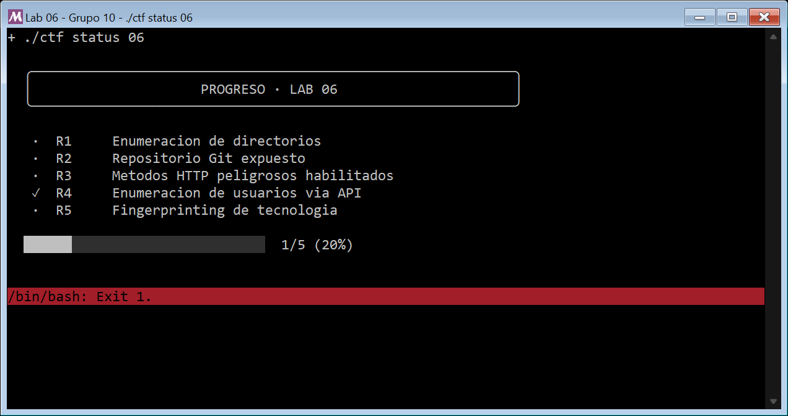

# Informe — Laboratorio 06 · Enumeración

**Grupo:** 10 · **Fecha:** 2026-11-03

**Integrantes:**

| Nombre y apellido | Usuario de GitHub |
|---|---|
| Belén Rocío Ramello | @belramello |
| Carolina Paula Corazza | @carocor1 |
| Chiara Agustina Kordek | @chiarakordek |
| Juan Pablo Saby | @JuanSaby |

---

## 0. Declaración de uso de IA

En cumplimiento con las directivas de `CONTRIBUTING.md`, se declara el uso de **Antigravity + Claude** y **OpenCode con GPT-6.1 Sol (OpenAI)** durante el desarrollo del laboratorio:
- **Finalidad de uso:** Asistencia en la revisión de la consigna, planificación metodológica, análisis de la estructura interna de Git (objetos, zlib, árboles y blobs), análisis de respuestas de la API y redacción técnica.
- **Partes asistidas:** Metodología y documentación de la exposición de Git y la enumeración de usuarios; organización de evidencias e integración del informe. OpenCode ejecutó las consultas de la API contra el contenedor autorizado y obtuvo la captura directa de la ventana de Git Bash/Mintty mediante la función de captura de ventanas de Windows.
- **Verificación:** Los análisis se contrastaron con las solicitudes y respuestas reales de `curl`, sus códigos HTTP y cabeceras. Para el repositorio expuesto se validó el hash SHA-256 de la flag contra `retos.manifest`; para la API se comprobó la aceptación de la flag por el motor oficial y se conservaron las salidas del envío y del estado CTF.

---

## 1. Flags capturadas

Registro previo de R2: salida oficial del comando `./ctf status 06`, conservada sin cambios:

```
  ╭────────────────────────────────────────────────────────────╮
  │                     PROGRESO · LAB 06                     │
  ╰────────────────────────────────────────────────────────────╯

   ·  R1     Enumeracion de directorios
   ✓  R2     Repositorio Git expuesto
   ·  R3     Metodos HTTP peligrosos habilitados
   ·  R4     Enumeracion de usuarios via API
   ·  R5     Fingerprinting de tecnologia

  ██████░░░░░░░░░░░░░░░░░░░░░░░░  1/5 (20%)
```

### Validación de R4 — Enumeración de usuarios mediante API

La flag `FLAG{user_enumeration_api}` se recuperó del campo `flag` de la respuesta HTTP de `/api/users`. Se envió con `./ctf submit 06 R4 'FLAG{user_enumeration_api}'`; el motor oficial respondió con código de salida `0`:

```text
[ OK ] Reto R4 resuelto: Enumeracion de usuarios via API
```

Evidencia: [envío completo de R4](evidencia/salidas/r4_04_ctf_submit_r4.txt), [estado anterior](evidencia/salidas/r4_03_ctf_status_antes.txt) y [estado posterior](evidencia/salidas/r4_05_ctf_status_despues.txt), sin editar.



La imagen es una captura directa de la ventana de Git Bash/Mintty al volver a ejecutar `./ctf status 06`; se conserva también el [registro crudo de esa terminal](evidencia/salidas/r4_07_ctf_status_terminal.txt). Solo se capturó esa ventana, sin recrear la salida en un navegador ni incluir otras aplicaciones.

Antes de ejecutar R4 no existía `.progreso/06.done` en esta copia local: el estado pasó de `0/5` a `1/5`, con R4 marcado. El registro anterior de R2 corresponde a otra ejecución y se conserva como evidencia de ese trabajo; no se fabricó un estado consolidado. `ctf status` devuelve `1` porque el laboratorio completo aún no está resuelto; por eso Mintty muestra `/bin/bash: Exit 1`. Ese aviso no invalida R4: su aceptación está acreditada por `ctf submit`.

### Validación de R1 y R5 — Enumeración de directorios y Fingerprinting

Las flags de R1 y R5 se recuperaron de respuestas HTTP y se validaron con el motor oficial. En esta copia local el progreso partía de `0/5` (`.progreso/06.done` no existía aún; los registros de R2 y R4 corresponden a otras copias y se conservan como evidencia de ese trabajo, sin consolidar un estado ficticio). Tras enviar ambas flags, `./ctf status 06` pasó a `2/5` con R1 y R5 marcados:

- **R1:** `FLAG{dir_enumeration_backup}`, recuperada del listado de `/backup/`. Enviada con `./ctf submit 06 R1 'FLAG{dir_enumeration_backup}'`; el motor respondió `[ OK ] Reto R1 resuelto`.
- **R5:** `FLAG{tech_fingerprint_phantomcms}`, recuperada del archivo default `/phantomcms/VERSION`. Enviada con `./ctf submit 06 R5 'FLAG{tech_fingerprint_phantomcms}'`; el motor respondió `[ OK ] Reto R5 resuelto`.

Evidencia: [estado anterior](evidencia/salidas/r1r5_01_status_antes.txt), [envío de R1](evidencia/salidas/r1_04_ctf_submit.txt), [envío de R5](evidencia/salidas/r5_03_ctf_submit.txt) y [estado posterior](evidencia/salidas/r1r5_02_status_despues.txt), sin editar.


---

## 2. Inventario de enumeración

| Hallazgo | Ruta/Método | Técnica | Evidencia | Riesgo | ¿Qué habilita para el Lab 07? |
|---|---|---|---|---|---|
| **R1 — Directorio de respaldos con listado accesible** | `GET /backup/` | Enumeración de directorios con `dirb` (wordlist común) y verificación con `curl` | [hallazgos de `dirb`](evidencia/salidas/r1_01_dirb_hallazgos.txt); [listado de `/backup/`](evidencia/salidas/r1_02_backup_listing.txt); [rutas conocidas con `http-enum`](evidencia/salidas/r1_03_http_enum.txt) | **Medio (demostrado):** el servidor devuelve el índice del directorio y nombra respaldos sensibles (`respaldo-db-2024.sql.gz`, `config.old`). En esta instancia los archivos individuales devolvieron 404, por lo que no se descargó contenido; el impacto demostrado es el listado de directorios habilitado y la divulgación de la existencia y los nombres de esos respaldos. `/admin` existe pero responde 403 | Los nombres `respaldo-db-2024.sql.gz` (volcado de base) y `config.old` señalan objetivos concretos para intentar recuperar en el Lab 07, por ejemplo mediante el path traversal de `GET /descargar?archivo=` |
| **Repositorio Git expuesto (Configuración y URL interna)** | `GET /.git/config` | Petición HTTP directa a rutas predecibles de control de versiones | Código `200 OK`, `Content-Type: text/plain`. Revela `bare = false` y `url = https://git.internal.phantomcorp/intranet.git` junto a comentarios de desarrollo | **Medio** (Demostrado). Divulgación de arquitectura interna y ubicación del repositorio central de código. No escala a Crítico en este servidor porque `.git/objects/` e historial no son accesibles (404) | Permite identificar el nombre del repositorio interno (`intranet.git`) y el dominio de desarrollo (`git.internal.phantomcorp`) para ataques dirigidos de falsificación de peticiones (SSRF) o pivot lateral |
| *(R3 - Pendiente)* | | | | | |
| **R4 — API interna que expone usuarios y roles sin autenticación** | `GET /api/users` | Enumeración dirigida de rutas de API con `curl` y análisis del JSON | [HTTP 200 y listado de usuarios](evidencia/salidas/r4_02_api_users_http.txt); [petición sin credenciales](evidencia/salidas/r4_02_api_users_peticion.txt) | **Medio, valoración cualitativa:** exposición demostrada de tres usuarios, sus identificadores y roles. Permite reconocer cuentas y priorizar objetivos; no demuestra acceso a ellas ni recuperación de contraseñas | Nombres para orientar futuras pruebas de autenticación e IDs `1`, `2` y `3` para investigar autorización por objeto, si el endpoint del Lab 07 utiliza esos mismos identificadores. No demuestra IDOR por sí solo |
| **R5 — CMS y versión expuestos (fingerprinting)** | `GET /` (cabeceras y `<meta generator>`) y `GET /phantomcms/VERSION` | Fingerprinting con `whatweb -a 3` y confirmación con `curl` | [salida de `whatweb`](evidencia/salidas/r5_01_whatweb.txt); [archivo default del CMS](evidencia/salidas/r5_02_version_default.txt) | **Medio (demostrado):** el stack se publica en claro (`Server: PhantomServer/3.7`, `X-Powered-By: PhantomCMS/3.7`, `<meta generator>` PhantomCMS 3.7) y el archivo default `/phantomcms/VERSION` confirma producto, versión y build (`PhantomCMS 3.7 (build 2024-11)`). No se identificó un CVE aplicable a este producto ficticio; el riesgo es la exposición de versión | Conocer producto, versión y build exactos permite buscar vulnerabilidades específicas de esa versión antes de la explotación; la convención del archivo default (`/phantomcms/VERSION`) es en sí un vector de enumeración reutilizable |

### Evidencia de soporte del inventario (R2)

#### 1. Petición y respuesta a `/.git/config`
```http
GET http://phantomcorp/.git/config HTTP/1.1
Host: phantomcorp

HTTP/1.0 200 OK
Server: PhantomServer/3.7 
Date: Sun, 01 Nov 2026 21:45:02 GMT
Content-Type: text/plain; charset=utf-8
X-Powered-By: PhantomCMS/3.7

[core]
	repositoryformatversion = 0
	bare = false
[remote "origin"]
	url = https://git.internal.phantomcorp/intranet.git
# Un .git expuesto filtra codigo, historia y a veces secretos.
# FLAG{git_repo_exposed}
```

#### 2. Comprobación de límites de exposición (Inaccesibilidad de objetos/historial)
```http
GET http://phantomcorp/.git/HEAD HTTP/1.1 -> 404 Not Found
GET http://phantomcorp/.git/logs/HEAD HTTP/1.1 -> 404 Not Found
GET http://phantomcorp/.git/index HTTP/1.1 -> 404 Not Found
GET http://phantomcorp/.git/objects/info/packs HTTP/1.1 -> 404 Not Found
GET http://phantomcorp/.git/description HTTP/1.1 -> 404 Not Found
```

### Evidencia de soporte del inventario (R4)

**Fecha de ejecución:** 2026-11-03.

#### 1. Alcance y entorno

La consigna pide identificar una API interna que lista personal. Se tomó como punto de partida la pista `/api/...` y el ejemplo `/api/users` publicado en el enunciado. Se realizaron únicamente dos solicitudes `GET` al objetivo de la cátedra, sin credenciales, cookies ni cabecera `Authorization`; no se afirma haber inventariado toda la API.

Los contenedores preexistentes correspondían a otros laboratorios. Para no reemplazarlos, se construyó el objetivo del **Lab 06** en el proyecto independiente `lab06-r4-carolina`, con el [Compose de reproducción](evidencia/entorno-r4.compose.yml). La red es interna, sin puertos publicados al host ni montajes del repositorio o de archivos personales. Al finalizar se detuvieron únicamente los dos contenedores de ese proyecto.

No se obtuvo la flag leyendo el código del objetivo ni `solucion.md`; se recuperó de la respuesta HTTP. No se ejecutaron pruebas de autenticación, fuerza bruta ni explotación del Lab 07.

#### 2. Rutas consultadas y respuestas

| Orden | Solicitud | Respuesta observada | Interpretación |
|---|---|---|---|
| 1 | `GET http://phantomcorp/api` | `404 Not Found`, `Content-Type: text/html; charset=utf-8` | Esta ruta concreta no devuelve un índice de API; no permite concluir que no existan subrutas. |
| 2 | `GET http://phantomcorp/api/users` | `200 OK`, `Content-Type: application/json` | Devuelve directamente el listado de personal y la flag, sin iniciar sesión. |

Se conservan la [traza de la petición a `/api`](evidencia/salidas/r4_01_api_peticion.txt) y su [respuesta cruda](evidencia/salidas/r4_01_api_http.txt), incluido el resultado negativo. El código de salida `0` de `curl` indica que completó la transferencia, no que el HTTP 404 sea un resultado exitoso de enumeración.

Extracto de la [solicitud real que permitió enumerar usuarios](evidencia/salidas/r4_02_api_users_peticion.txt):

```text
> GET /api/users HTTP/1.1
> Host: phantomcorp
> User-Agent: curl/8.14.1
> Accept: */*
>
```

Cabeceras y cuerpo de la [respuesta cruda](evidencia/salidas/r4_02_api_users_http.txt). El cuerpo se conserva en una línea, como fue recibido:

```http
HTTP/1.0 200 OK
Server: PhantomServer/3.7
Date: Tue, 03 Nov 2026 19:33:22 GMT
Content-Type: application/json
X-Powered-By: PhantomCMS/3.7

{"users": [{"id": 1, "user": "admin", "role": "superuser"}, {"id": 2, "user": "jperez", "role": "editor"}, {"id": 3, "user": "mgomez", "role": "viewer"}], "note": "endpoint interno de RRHH - no exponer", "flag": "FLAG{user_enumeration_api}"}
```

#### 3. Usuarios identificados y límites de la comprobación

| ID publicado | Usuario publicado | Rol declarado por la API |
|---|---|---|
| 1 | `admin` | `superuser` |
| 2 | `jperez` | `editor` |
| 3 | `mgomez` | `viewer` |

La API identifica directamente estos tres usuarios del escenario, sin inferirlos mediante diferencias en mensajes de error. La nota `endpoint interno de RRHH - no exponer` refuerza que el listado está destinado a uso interno. No se comprobó si las cuentas permiten iniciar sesión ni si sus roles se aplican correctamente: la evidencia demuestra su publicación, no el control de las cuentas.

La respuesta no incluye contraseñas, hashes, correos ni tokens de sesión. Los nombres y la flag pertenecen al entorno ficticio de la cátedra, no a personas o servicios externos.

#### 4. Riesgo de la exposición

El impacto demostrado es sobre la **confidencialidad**: cualquier cliente con conectividad HTTP al servicio puede obtener el listado observado sin aportar credenciales. No se demostró que el contenedor fuera accesible desde Internet, ni que se pudiera modificar información o afectar la disponibilidad.

Conocer usuarios válidos reduce la incertidumbre para futuras pruebas de autenticación: en lugar de adivinar simultáneamente usuario y contraseña, un atacante puede concentrarse en las cuentas publicadas. El rol `superuser` señala a `admin` como un objetivo potencialmente más valioso, aunque no se hayan probado sus permisos efectivos. Los identificadores consecutivos revelan referencias concretas que pueden orientar la revisión de controles de acceso.

La valoración **media** se fundamenta en la exposición anónima de identidades y roles internos con una sola solicitud, sin evidencia de contraseñas, sesiones, acceso a cuentas ni una cadena de explotación completada. No se asigna un CVSS ni se presenta como una vulnerabilidad crítica sin pruebas que lo respalden.

#### 5. Información aprovechable para el Lab 07

- **Usuarios:** `admin`, `jperez` y `mgomez` son entradas conocidas para planificar pruebas de autenticación autorizadas, sin afirmar que ya se haya obtenido acceso.
- **Roles declarados:** `superuser`, `editor` y `viewer` permiten definir qué diferencias de permisos deberían revisarse en la fase de explotación.
- **Identificadores:** `1`, `2` y `3` podrían utilizarse para investigar autorización por objeto en `GET /perfil?id=`, si se confirma que ambas partes del escenario comparten esos IDs. Conocer un ID no habilita por sí mismo a leer el perfil correspondiente.

En R4 no se consultó `/perfil`, no se modificaron identificadores para acceder a perfiles y no se resolvió IDOR. Esa conexión es una hipótesis de trabajo para el Lab 07, no un resultado ya demostrado.

#### 6. Fuentes del análisis de R4

- [Consigna del Lab 06](../../../labs/lab06-enumeracion-de-servicios/README.md), [rúbrica](../../../labs/lab06-enumeracion-de-servicios/docs/rubrica.md) y [protocolo de evidencia](../../../docs/PROTOCOLO-EVIDENCIA.md).
- [OWASP WSTG v4.2 — Testing for Account Enumeration and Guessable User Account](https://owasp.org/www-project-web-security-testing-guide/v42/4-Web_Application_Security_Testing/03-Identity_Management_Testing/04-Testing_for_Account_Enumeration_and_Guessable_User_Account): fundamento del riesgo de revelar usuarios. Sus pruebas sobre autenticación no se ejecutaron aquí; se observó una divulgación directa mediante API.
- [MITRE — CWE-200](https://cwe.mitre.org/data/definitions/200.html): referencia conceptual sobre exposición de información y confidencialidad, no una clasificación de causa raíz ni una estimación automática de severidad.
- Documentación oficial de Docker, consultada mediante Context7: [directorio de proyecto de Compose](https://docs.docker.com/reference/cli/docker/compose/) y [redes internas](https://docs.docker.com/reference/compose-file/networks/#internal).

### Evidencia de soporte del inventario (R1)

**Fecha de ejecución:** 2026-11-05.

#### 1. Enumeración de directorios

Se ejecutó `dirb` con la wordlist común contra el objetivo autorizado `phantomcorp`. Reportó dos rutas: `/admin` con código `403` (existe pero está protegida) y `/backup` con código `200` (accesible). Un barrido adicional con `gobuster` sobre `big.txt` y el script `http-enum` de Nmap no agregaron rutas nuevas; `http-enum` también señaló `/backup/` como posible respaldo. Se conservan los [hallazgos de `dirb`](evidencia/salidas/r1_01_dirb_hallazgos.txt) y la [salida de `http-enum`](evidencia/salidas/r1_03_http_enum.txt).

#### 2. Recurso sensible expuesto

La solicitud `GET /backup/` devolvió `200 OK` con un índice de directorio que lista `respaldo-db-2024.sql.gz`, `config.old` y `notas-infra.txt`, y la propia página admite que «este directorio no deberia estar accesible». La flag `FLAG{dir_enumeration_backup}` aparece en ese listado ([captura](evidencia/salidas/r1_02_backup_listing.txt)). Al pedir los archivos individuales (`/backup/config.old`, `/backup/notas-infra.txt`) el servidor respondió `404`: en esta instancia el índice es una página estática y no se descargó el contenido de los respaldos. El hallazgo demostrado es, por lo tanto, el listado de directorio habilitado y la divulgación de la existencia y los nombres de respaldos sensibles, no la exfiltración de esos archivos.

#### 3. Riesgo e información para el Lab 07

El listado revela que existen un volcado de base de datos (`respaldo-db-2024.sql.gz`) y una configuración antigua (`config.old`). Aunque aquí no se pudieron descargar, son objetivos concretos para la fase de explotación: el endpoint `GET /descargar?archivo=` del Lab 07 (path traversal) es un camino para intentar alcanzar precisamente ese tipo de archivos fuera del directorio público. Como mitigación, conviene deshabilitar el listado de directorios y retirar los respaldos del árbol servido por el servidor web.

### Evidencia de soporte del inventario (R5)

**Fecha de ejecución:** 2026-11-05.

#### 1. Fingerprinting del stack

`whatweb -a 3 http://phantomcorp` identificó el servidor y el CMS a partir de las respuestas HTTP: `HTTPServer [PhantomServer/3.7]`, `X-Powered-By [PhantomCMS/3.7]` y `MetaGenerator [PhantomCMS 3.7]`, además del título «Intranet PhantomCorp» ([salida de `whatweb`](evidencia/salidas/r5_01_whatweb.txt)). Las mismas cabeceras y la etiqueta `<meta name="generator" content="PhantomCMS 3.7">` ya se observaban en la respuesta de la raíz capturada en R2.

#### 2. Archivo default del CMS

Con el producto identificado, se buscó su archivo default. La ruta `GET /phantomcms/VERSION` devolvió `200 OK` con `PhantomCMS 3.7 (build 2024-11)` y el texto «Archivo default del CMS. Si llegaste aca por fingerprinting, bien.», junto con la flag `FLAG{tech_fingerprint_phantomcms}` ([captura](evidencia/salidas/r5_02_version_default.txt)). El archivo se localizó por enumeración de rutas, no leyendo el código del objetivo.

#### 3. Riesgo asociado a la exposición tecnológica

Publicar producto, versión y build exactos (en cabeceras, en `<meta generator>` y en un archivo default) le ahorra trabajo de reconocimiento a un atacante: puede buscar directamente vulnerabilidades conocidas de esa versión concreta. No se identificó un CVE aplicable a PhantomCMS, por tratarse de un producto ficticio del laboratorio, de modo que no se asigna severidad por un CVE inexistente; el riesgo demostrado es la divulgación de versión. Como mitigación, conviene suprimir o normalizar las cabeceras `Server` y `X-Powered-By`, quitar la etiqueta `generator` y retirar el archivo default del CMS del servidor público.

---

## 3. Preguntas de análisis

### P1 — Enumeración vs. recon.
*(A completar por el integrante asignado)*

### P2 — El `.git` expuesto
**Consigna:** *El `.git` expuesto: explicá qué podría reconstruir un atacante con él y por qué es más grave que "un archivo de más".*

**Respuesta fundamentada:**
Un archivo convencional expuesto (como una página HTML o un PDF) solo revela información estática y aislada. En contraste, el directorio `.git/` contiene la estructura completa del sistema de control de versiones (árbol de objetos, ramas, índices y reflogs). Si la exposición es completa, un atacante no solo descarga el archivo que está en producción, sino que puede reconstruir el **código fuente íntegro de la aplicación con todo su historial de cambios**:
1. **Acceso a objetos comprimidos (`.git/objects/`):** Al descargar secuencialmente los commits, árboles (*trees*) y blobs (descomprimiéndolos con zlib), se restaura el árbol de trabajo completo con la totalidad de los archivos de la aplicación.
2. **Historial y diferencias temporales:** A través de los objetos `commit` y `parent`, un atacante puede ejecutar operaciones equivalentes a `git log` y `git diff`. Esto permite inspeccionar código histórico, revisiones anteriores y notas de desarrollo.
3. **Fuga de secretos commiteados por error:** Frecuentemente los desarrolladores commitean contraseñas de bases de datos, tokens de API o claves privadas que luego son "eliminadas" en commits posteriores. Como Git mantiene los snapshots históricos en sus blobs, el atacante recupera las credenciales en claro con solo inspeccionar commits pasados.
4. **Auditoría de caja blanca (White-box):** Contar con el código fuente le permite al atacante analizar vulnerabilidades de lógica, inyecciones SQL o fallas de autenticación con precisión absoluta, eliminando la necesidad de realizar pruebas a ciegas.

En el caso puntual analizado en PhantomCorp, se constató empíricamente que el servidor expone únicamente `/.git/config` (devolviendo 404 para `HEAD`, `logs/` y `objects/`). Por lo tanto, aunque no fue posible reconstruir el árbol de objetos localmente, la exposición reveló información sensible de infraestructura interna (URL del repositorio interno).

### P3 — El método `PUT`.
*(A completar por el integrante asignado)*

### P4 — Enumeración de usuarios.
*(A completar por el integrante asignado)*

### P5 — Rol defensor (Mitigaciones)
**Mitigación para Repositorio Git expuesto (Hallazgo R2):**
1. **Regla de denegación en servidor web / proxy inverso:** Configurar una directiva explícita que bloquee de forma estricta cualquier petición dirigida a archivos o directorios ocultos que comiencen con punto (`.`).
   - *Ejemplo en Nginx:*
     ```nginx
     location ~ /\.git {
         deny all;
         return 404;
     }
     ```
   - *Ejemplo en Apache:*
     ```apache
     <DirectoryMatch "/\.git">
         Require all denied
     </DirectoryMatch>
     ```
2. **Higiene en pipelines de despliegue (CI/CD):**
   - No utilizar `git clone` o `git pull` directamente en el directorio público servido (`/var/www/html` o `/app`).
   - Implementar artefactos de compilación limpios mediante `git archive` o contenedores multi-etapa (*multi-stage Docker builds*) donde únicamente se copien los archivos finales de producción y se descarte por completo la carpeta `.git`.
3. **Escaneo automatizado de repositorios:**
   - Incorporar herramientas de análisis estático como `gitleaks` o `trufflehog` en los hooks de pre-commit y pipelines para evitar que configuraciones sensibles o comentarios con información interna queden registrados en el repositorio.

*(Las 2 mitigaciones restantes serán completadas por los integrantes según sus hallazgos).*

---

## 4. Bitácora de comandos

```bash
# Verificación de conectividad general
curl -i -s http://phantomcorp/

# Inspección de configuración de Git
curl -i -s http://phantomcorp/.git/config

# Sondeo de referencias y metadatos adicionales
curl -i -s http://phantomcorp/.git/HEAD
curl -i -s http://phantomcorp/.git/logs/HEAD
curl -i -s http://phantomcorp/.git/index
curl -i -s http://phantomcorp/.git/objects/info/packs
curl -i -s http://phantomcorp/.git/description
curl -i -s http://phantomcorp/.git/COMMIT_EDITMSG
curl -i -s http://phantomcorp/.git/

# Validación criptográfica de la flag
echo -n 'FLAG{git_repo_exposed}' | sha256sum

# Registro en el CTF
./ctf submit 06 R2 'FLAG{git_repo_exposed}'
./ctf status 06
```

### Comandos de R4 (2026-11-03)

El listado con las redirecciones, los códigos de salida y las notas de ejecución está incorporado en [evidencia/comandos.txt](evidencia/comandos.txt). Las salidas crudas de R4 están en la carpeta común [evidencia/salidas/](evidencia/salidas/), con prefijo `r4_` para no sobrescribir las de otros retos. Las rutas siguientes corresponden a su ubicación final, después de integrar las evidencias.

```bash
# Desde la raíz del repositorio: levantar la instancia aislada del Lab 06.
docker compose -p lab06-r4-carolina --project-directory . -f entregas/lab06/grupo10/evidencia/entorno-r4.compose.yml up -d --build

# Consultas dirigidas a la API, sin autenticación.
docker compose -p lab06-r4-carolina --project-directory . -f entregas/lab06/grupo10/evidencia/entorno-r4.compose.yml exec -T attacker curl --noproxy '*' --silent --show-error --connect-timeout 5 --max-time 15 --include --verbose http://phantomcorp/api
docker compose -p lab06-r4-carolina --project-directory . -f entregas/lab06/grupo10/evidencia/entorno-r4.compose.yml exec -T attacker curl --noproxy '*' --silent --show-error --connect-timeout 5 --max-time 15 --include --verbose http://phantomcorp/api/users

# Estado previo, validación de la flag recibida y estado posterior (Git Bash).
./ctf status 06
./ctf submit 06 R4 'FLAG{user_enumeration_api}'
./ctf status 06

# Detener solamente la instancia creada para R4.
docker compose -p lab06-r4-carolina --project-directory . -f entregas/lab06/grupo10/evidencia/entorno-r4.compose.yml stop
```

Las salidas de R4 se guardaron mediante redirección de `stdout` y `stderr` a archivos binarios desde `subprocess.run`, sin edición manual ni conversión de codificación. Su reubicación a la carpeta común no cambió sus bytes. Los tres archivos `stderr` vacíos del CTF indican que no hubo mensajes en ese canal. El archivo `r4_06_entorno_stop_stdout.txt` también está vacío porque Docker informó la detención por `stderr`, conservado en `r4_06_entorno_stop_stderr.txt`. Estos archivos vacíos son registros de canales sin mensajes, no evidencias pendientes de completar.

Para reproducir se necesita Docker y la imagen local `cyberlab-attacker`, construida con la preparación oficial del curso. En Windows, los comandos `./ctf` se ejecutan con Git Bash. Las IP y fechas pueden variar al recrear el entorno; las evidencias originales no deben sobrescribirse al repetir las pruebas.

